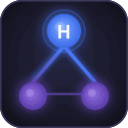
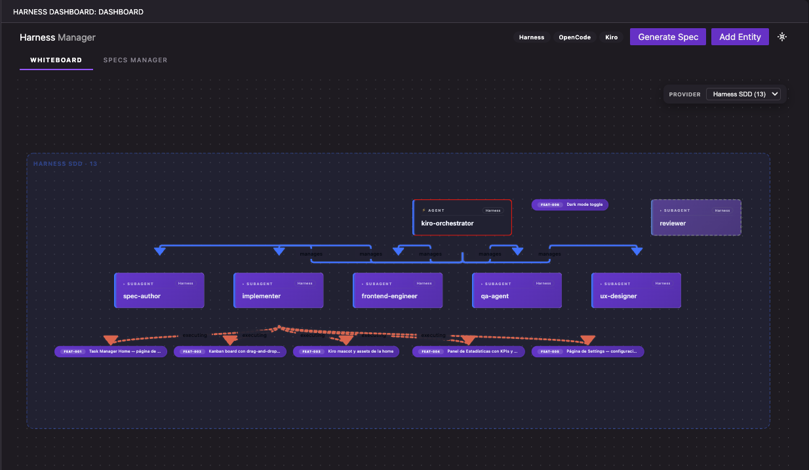
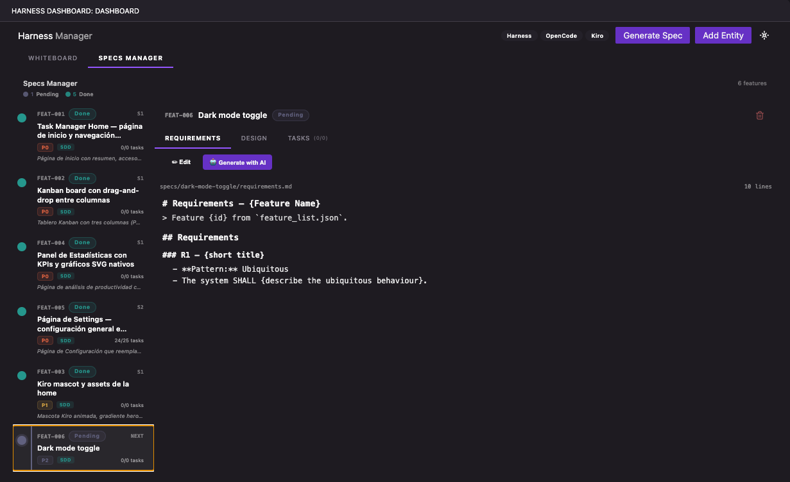
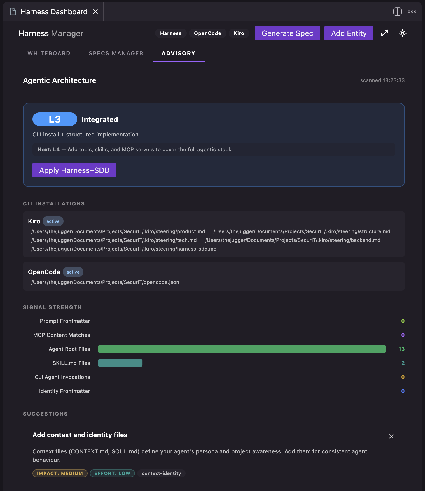
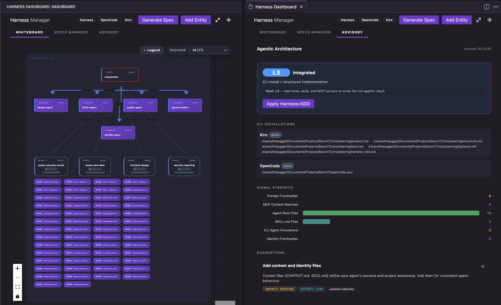
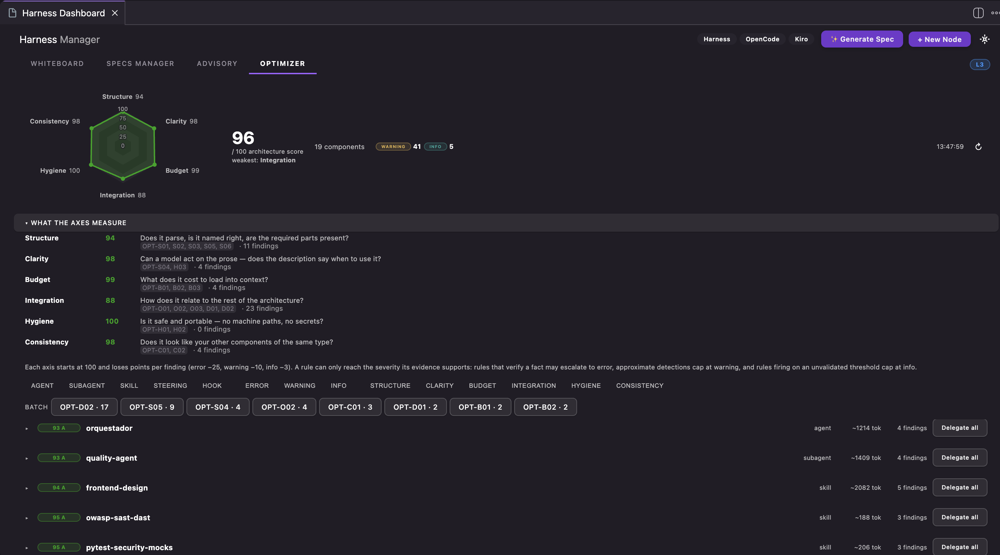

# Harness Dashboard

**See, check and price the AI agent harness you already have** — agents, subagents, skills, rules and hooks, in any supported format or your own layout. Bring Your Own Harness: no framework is privileged.

[](https://github.com/marcmassa/harness-manager/actions/workflows/ci.yml)
[](https://github.com/marcmassa/harness-manager/releases)
[](https://code.visualstudio.com/updates/v1_85)



---

## Screenshots

| Whiteboard | SDD Panel |
|---|---|
|  |  |
| **Architecture Analysis & Advisory** | **Editor Dashboard** |
|  |  |
| **Component Optimizer** *(new in 0.8.0)* | |
|  | |
<!-- Second cell awaits media/screenshots/chat-handoff.png — a finding's prompt arriving prefilled in the host editor's chat. See progress/backlog.md. -->

---

## What it does

Harness Dashboard reads your workspace and renders an interactive graph of your AI agent setup:

- **Nodes** — Agents, Subagents, Skills (architectural hierarchy) and Features (compact grid, below the agent graph)
- **Edges** — `manages`, `uses`, `suggested`, `discovered` relationships with semantic coloring
- **Semantic suggestions** — TF-IDF cosine similarity recommends missing skill connections
- **Detail panel** — click any node to read its description and Markdown file inline
- **Advisory** — maturity and suggestions derived from evidence each provider actually supplies
- **Optimizer** — every component scored only against the rules its format supports, with coverage instead of false scores
- **Context cost** — what each harness costs per session, from the load modes its owner declares
- **Specs Manager** — feature and spec progress, shown whenever a provider supplies feature or spec data

Built-in providers read Claude Code, Gemini CLI, Cursor, GitHub Copilot, OpenCode, Kiro and Harness SDD; any other layout is read through a declared **harness profile**, and other extensions can register providers through the companion API (see [Supported project structures](#supported-project-structures)).

---

## Features

| Feature | Description |
|---------|-------------|
| 🗺 **Whiteboard canvas** | Drag-and-drop, zoom, pan — powered by React Flow |
| 🔗 **Edge types** | `manages`, `uses`, `governs`, `triggers`, `suggested`, `discovered` — each with semantic coloring and arrow style |
| 🧱 **Agent Builder Wizard** | Unified modal for creating any node type (agent, subagent, skill, steering, hook, feature-spec) with guided and advanced modes |
| 💡 **Semantic skill discovery** | Suggests subagent↔skill connections from description text |
| 📋 **Inline Markdown viewer** | Read SUBAGENT.md / SKILL.md without leaving the panel |
| ✏️ **Edit in editor** | Open any Markdown file directly in the VS Code editor |
| 🔍 **Idoneity scoring** | Shows best semantic owner per skill, highlights mismatches |
| ⏸ **Toggle connections** | Disable/enable skill connections persistently |
| 🚫 **Dismiss suggestions** | Permanently hide unwanted suggestions (persisted across reloads) |
| 📅 **Progress timeline** | Feature lifecycle (pending → done) for providers that supply feature data |
| 🧭 **Steering & Hooks nodes** | Visualise steering files and hook scripts on the whiteboard, with relationship edges to subagents and agents |
| 📐 **Specs Manager** | Browse and edit spec files (requirements, design, tasks) per feature, with AI-assisted generation; shown when a provider supplies feature or spec data |
| 🔄 **Cross-framework discovery** | Find hooks and steering files from any agentic framework (Harness, Kiro, Claude Code, etc.) |
| 🤖 **Universal AI Provider** | Provider chain (`vscode.lm` → OpenAI-compatible API fallback) works in any IDE without Copilot |
| 🔍 **Agentic Architecture Detection** | Scans any workspace for agentic signals (prompts, rules, MCP, frameworks, tools, skills, memory, context), classifies maturity L0–L5, identifies architectural patterns, and generates actionable improvement suggestions |
| 🧩 **Discovered Node Visualization** | Detected CLI installs, agent implementations, Harness SDD, and methodology elements appear on the whiteboard with layer badges (`[CLI]`, `[IMPL]`, `[HARNESS]`, `[SDD]`) and dashed/solid borders |
| 📊 **SVG Signal Bar Chart** | See signal strength across 9 categories at a glance in the Advisory tab |
| 🚀 **Optional adoption** | Scaffold a Harness SDD layout from detected signals — offered, never required |
| 🩺 **Component Optimizer** | Scores every agent, subagent, skill, steering and hook 0–100 across six dimensions — 19 deterministic rules, thresholds calibrated against your own corpus, no LLM — with a dimension radar and quick fixes previewed in a diff |
| 🤖 **Assisted fixes** | For findings with no mechanical fix: AI Refine proposes a rewrite through your editor's model where the host exposes one (`vscode.lm`), or a configured API; Delegate hands a scoped task to an installed terminal agent |
| 🧳 **Bring Your Own Harness** | Declare any folder layout as a harness profile (`.harness-dashboard/config.json`) and it is read, scored and priced like a built-in format; companion extensions register providers through a read-only API *(new in 0.9.0)* |
| 💸 **Context cost** | Per-session token cost per provider (baseline, skill catalog, on-demand), offline money estimates from your own price table, the Dashboard's own model usage, and a comparison with git HEAD *(new in 0.9.0)* |
| 🗂 **Native Sources & Findings views** | Type icons, per-provider session cost, load mode, tokens and score per resource, findings coloured like the Problems view, and an Open Dashboard entry *(new in 0.9.0)* |
| 🔲 **Editor Dashboard** | The Dashboard is one editor tab, restored after a reload on the tab you left; the Activity Bar keeps light native Sources and Findings views |

---

## What's new in 0.9.0

**Bring Your Own Harness.** Every capability reads, evaluates and prices the harness a workspace already has, with no framework assumed.

- **Sources and ownership** — each resource keeps its provider, native path and load mode; one host decision says which operations each owner supports. Custom layouts are declared as profiles; companion extensions add providers through a read-only API.
- **Advisory and maturity** — findings and maturity come from attributed evidence and capabilities, not from which framework is installed.
- **Optimizer** — only applicable rules per owner and format; components nothing could evaluate show coverage instead of a score.
- **Context cost** — per-session tokens from owner-declared load modes, unknown modes left unpriced, money estimates from your own price table, and a git HEAD comparison.
- **Fast, quiet startup** — activation registers only (about 50 ms); nothing is scanned until you open a Harness view or the Dashboard. The Activity Bar has native **Sources** and **Findings** views with type icons and an **Open Dashboard** entry; the Dashboard is one editor tab restored on its last tab, whose tabs load on first display. A five-step walkthrough covers the basics.
- **Smaller package** — 345 KB, down from 390 KB: the deprecated webview UI toolkit is replaced by native themed controls, the icon is palettised, and the npm supply-chain audit (outside the harness scope) is removed.

See the [CHANGELOG](./CHANGELOG.md) and the [v0.9.0 acceptance guide](docs/byoh/v0.9.0.md).

---

## Supported project structures

| Format | Detection file | Provider |
|-----------|---------------|--------|
| **Claude Code** | `CLAUDE.md` / `.claude/agents/` | built-in |
| **Gemini CLI** | `GEMINI.md` | built-in |
| **Cursor** | `.cursor/rules/` | built-in |
| **GitHub Copilot** | `.github/copilot-instructions.md` | built-in |
| **OpenCode** | `opencode.json` | built-in |
| **Kiro** | `.kiro/agents/` | built-in |
| **Harness SDD** | `.agents/agentic.json` | built-in |
| **Your own layout** | markers you declare | harness profile in `.harness-dashboard/config.json` |
| **Another extension's format** | its own | companion API v1 (read-only) |

What each provider can do (discovery, editing, runs, validation) is listed in [adapter capabilities](docs/byoh/adapter-capabilities.md).

> **Note on Windsurf:** the `WindsurfAdapter` source file still ships in the extension (the adapter was implemented in FEAT-015 before Windsurf was discontinued), but the table above does not advertise it because new users cannot realistically adopt a discontinued product. The adapter is retained for users with existing Windsurf workspaces. See `progress/decisions.md#adr-003-windsurf-discontinuation` for the rationale.

---

## Getting started

1. **Install** — download the latest VSIX from the [Releases page](https://github.com/marcmassa/harness-manager/releases) and install it via `Extensions: Install from VSIX...`, or install directly from the VS Code Marketplace (*coming soon*).
2. Open a workspace with any agent configuration — a supported format, or your own layout declared as a profile
3. Click the **Harness** icon in the Activity Bar: **Sources** lists each detected provider and the files it owns; **Findings** groups Advisory and Optimizer results by owner
4. Select **Open Dashboard** (first item, view toolbar or Command Palette) for the whiteboard, Advisory, Optimizer and, when there is feature data, the Specs Manager in an editor tab — or follow the *Get started with Harness Dashboard* walkthrough

> **No config needed.** Supported formats are detected automatically; for any other layout, declare a harness profile. Nothing is scanned until you open a Harness view or the Dashboard.

---

## Requirements

- VS Code 1.85 or newer
- A workspace with agent configuration in a supported format or a declared profile (see table above)

---

## Extension settings

State (dismissed suggestions, disabled connections) is persisted automatically per workspace via VS Code's `workspaceState`.

### Adapter path overrides

Per-adapter detection path overrides under `harness-dashboard.adapters.<id>.path`. The defaults match each framework's canonical detection directory; override them when your project places its agent files in a non-standard location. Configurable: `claude-code`, `cursor`, `gemini-cli`, `copilot`, `windsurf`, `kiro`. **Not** configurable: `harness-sdd` (canonical, `.agents/agentic.json`) and `opencode` (canonical, `opencode.json`/`opencode.jsonc`) — changing the path would break the framework's own tooling.

```json
{
  "harness-dashboard.adapters.kiro.path": ".kiro"
}
```

If a configured path is invalid (does not exist or is not a directory), the extension logs a one-line warning to the **Harness Dashboard** output channel and falls back to the framework's default. See [`docs/configuration.md`](docs/configuration.md) for the long-form ConfigurationRegistry reference.

### AI provider settings

Configure the OpenAI-compatible fallback provider to help define new specs with the specs panel:

| Setting | Default | Description |
|---------|---------|-------------|
| `harness-dashboard.ai.apiKey` | `""` | API key for fallback provider. Empty = fallback disabled. |
| `harness-dashboard.ai.endpoint` | `https://api.openai.com/v1/chat/completions` | Base URL for the API. Change for Ollama, Azure, LM Studio, etc. |
| `harness-dashboard.ai.model` | `gpt-4o-mini` | Model identifier sent in the request body. |


---

## Contributing

From the repository root, run the contributor quality checks on a TypeScript file with:

```sh
FILE=src/parserLogic.ts bash hooks/run-hooks.sh on_file_saved_kiss
FILE=src/parserLogic.ts bash hooks/run-hooks.sh on_file_saved_dry
```

These commands print JSON findings. The Dashboard has retired its Verify Code Quality
command and its `harness-dashboard.codeQuality.*` settings, including `blockOnSave`
and the development-branch name `warnBeforeSaveOnError`. Existing settings may be
removed at your convenience. Each workspace controls its own save hooks.

Issues and PRs welcome at [github.com/marcmassa/harness-manager](https://github.com/marcmassa/harness-manager).

---

## License

MIT © Marc Massa

---

## Note on the repository name

The **GitHub repository** is intentionally named `harness-manager`,
while the product, the VS Code extension, the npm package, the
VSIX file, and the VS Code Marketplace listing are all named
`harness-dashboard` (or `harness-dashboard-vscode` for the
package). The discrepancy is historical: the v0.1.0 release
of 2026-06-08 renamed the product from "Harness Manager" to
"Harness Dashboard" but the GitHub repository name was not
updated at that time.

This mismatch is **intentional and documented**. The decision
to keep the repository name as `harness-manager` (rather than
rename it to `harness-dashboard`) is recorded in
[`ADR-002`](./progress/decisions.md#adr-002-accept-the-github-repository-name-harness-manager-and-document-the-mismatch).
A future maintainer may choose to perform the rename at a
project milestone (e.g., v0.4.0 or v1.0.0); until then, the
two names refer to the same project.
